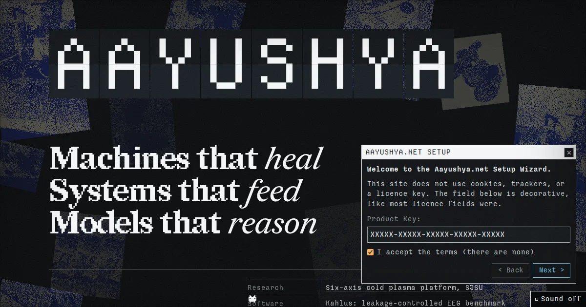
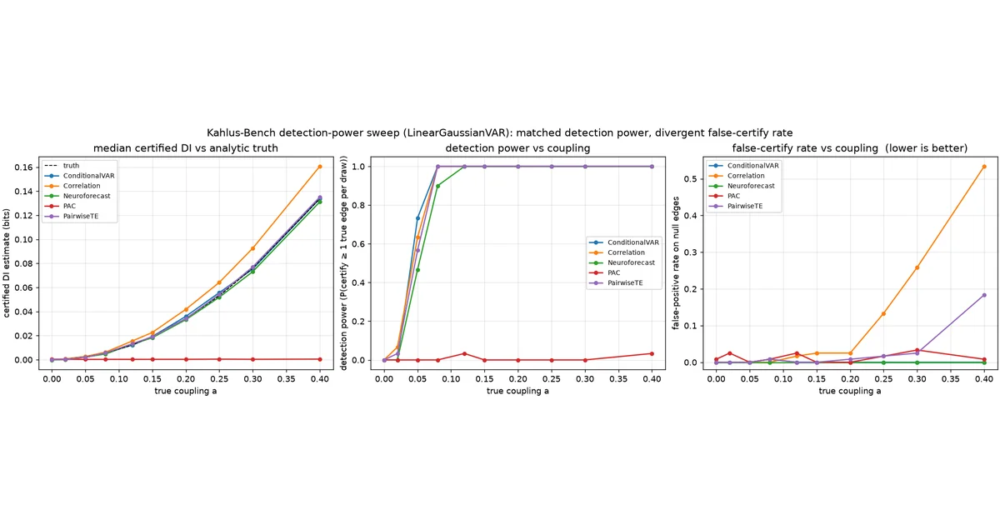
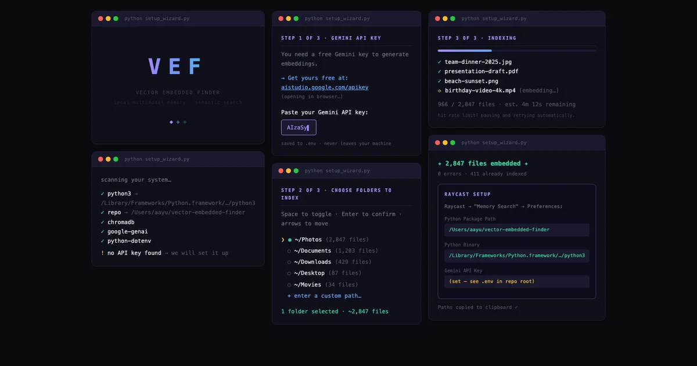
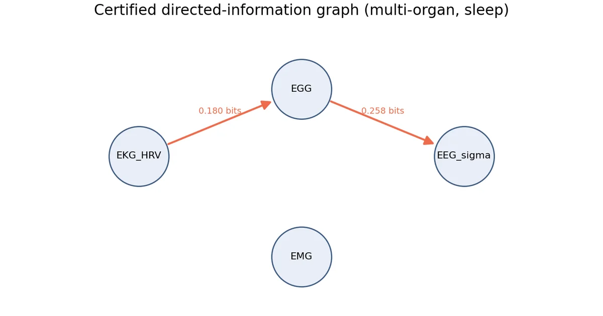

<table width="100%">
  <tr>
    <td valign="middle">
      
      <a href="https://github.com/ptlnextdoor" title="GitHub"><picture><source media="(prefers-color-scheme: dark)" srcset="https://cdn.simpleicons.org/github/ffffff"></picture></a>
      <b>Hey, I'm Aayushya 👋</b> Cupertino, CA · <a href="https://aayushya.net">aayushya.net</a>
    </td>
  </tr>
  <tr>
    <td align="center">
      
      
       
      
      
    </td>
  </tr>
  <tr>
    <td>
      <b>languages</b> 
      
      
      
      
      
    </td>
  </tr>
  <tr>
    <td>
      <b>ml / science</b> 
      
      
      
      
      
    </td>
  </tr>
  <tr>
    <td>
      <b>hardware / writing</b> 
      
      
      
      
    </td>
  </tr>
  <tr>
    <td>
      <b>infra / tools</b> 
      
      
      
      
      
      
    </td>
  </tr>
</table>

  

---

### What I actually work on

Neural forecasting, and the question of when a result is real. Most of what I build is a benchmark,
a bound, or a negative result I could not talk myself out of.

**[kahlus-bench](https://github.com/ptlnextdoor/kahlus-bench)** · **[neuroforecast](https://github.com/ptlnextdoor/neuroforecast)** —
Leakage-sealed benchmark for neural-coupling claims, and certified directed-information graphs for
multi-organ coupling. Finite-sample certified, not asymptotic hand-waving.

**[Recall](https://github.com/ptlnextdoor/Recall)** — Local second brain. One search box over files,
Gmail, Calendar, Drive, Canvas, Notion. Sub-200 ms semantic search, nothing leaves the machine.

**[kahlus-skills](https://github.com/ptlnextdoor/kahlus-skills)** — Agent skills for research artifacts
a skeptical PI would believe. One rule across all five: every number reproduces from a named command,
and scope is stated honestly.

**[hil-failure-modes](https://github.com/ptlnextdoor/hil-failure-modes)** — Six concrete failure modes
where AI-generated embedded firmware compiles clean and fails on real silicon.

Also: [mentra-eeg-miniapp](https://github.com/ptlnextdoor/mentra-eeg-miniapp) (live EEG-derived
cognitive-state readout on smart glasses) and
[bambu-studio-safe-updater](https://github.com/ptlnextdoor/bambu-studio-safe-updater).

---

### Private, and the reason the rest of this reads the way it does

Two repos below are private. I'd rather name them and say so than link a 404.

**Kahlus-V1** — Leakage-controlled EEG forecasting harness, the NeuroTwin research engine. Six evidence
gates, and **M3 and M4 are committed as `gate_passed: false`**. The failures ship with the repo, because
the point of a gate is knowing when the result isn't real.

**eeg-forecastability-limits** — How far ahead can you forecast raw scalp EEG? On BNCI2014_001 the
standard task builds a target that shares **127 of its 128 samples with the input**, so the score is
mostly copying. Rebuilt as a single strictly future sample: raw voltage reaches *r* = 0.885 at 4 ms,
0.176 by 256 ms, and is indistinguishable from guessing by ~1 s. Band-power envelopes are not — gamma
still scores *r* = 0.44 at 8 seconds. It also carries the correction to my own earlier README, which
turned out to be measuring my regularisation choice rather than the signal.

Happy to walk it through on request — [email](mailto:aayu22809@gmail.com).

---

### How I work

- Distrust green CI. The tests passing is a claim, not a result.
- If a baseline got 60 steps and mine got 400, I didn't win.
- Publish the failed gate. An honest smaller artifact beats an impressive-looking fake one.
- Agents as adversaries: propose framing, ask for the strictest possible critique, adopt, repeat.

---

<!--START_SECTION:waka-->
<!--END_SECTION:waka-->

IEEE ISEC 2026 (sole author) · ASME IMECE '25 · SCCUR '25 · NCUR '25, '26 · BMES Bay Area '26 
<a href="mailto:aayu22809@gmail.com">email</a> · <a href="https://aayushya.net">aayushya.net</a>

